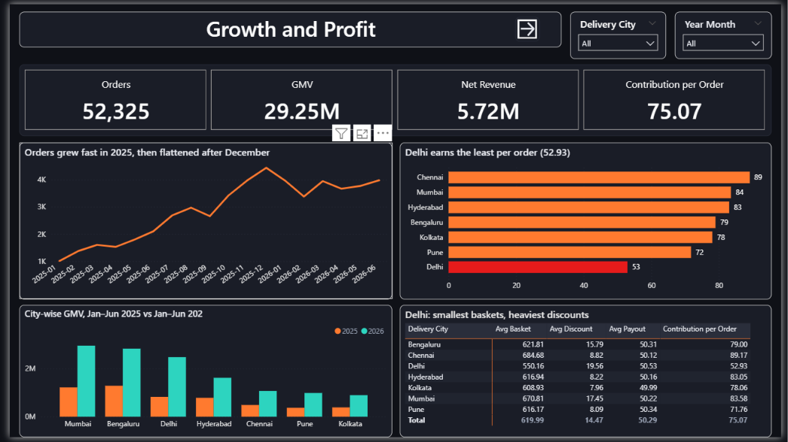
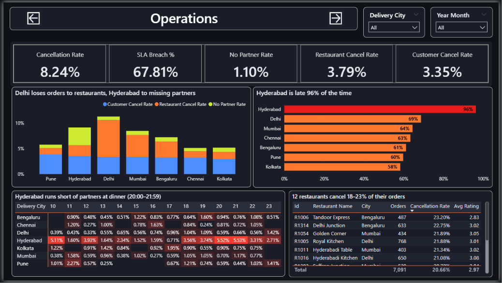
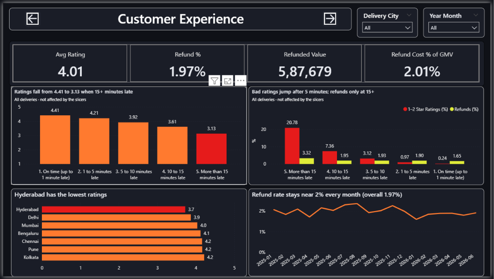
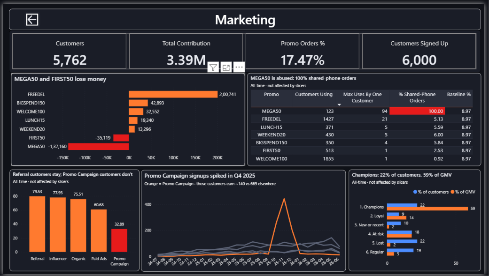
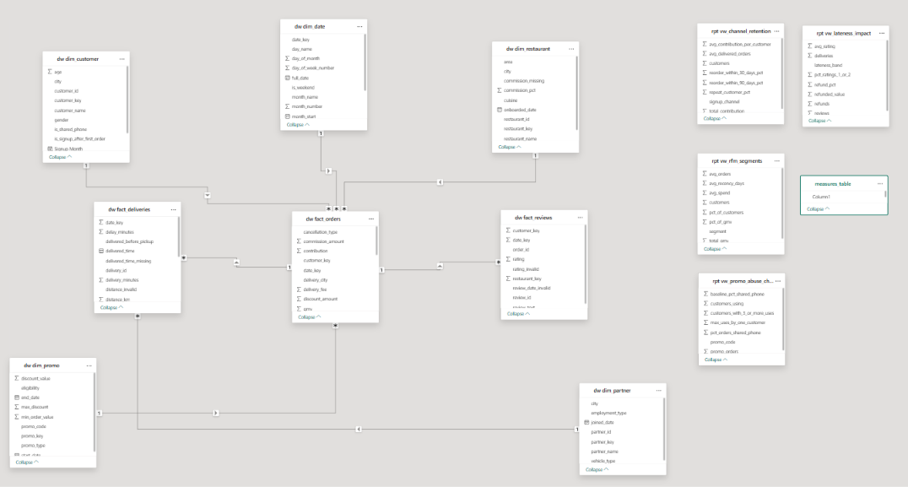

# QuickBite Food Delivery Analytics

**SQL Server + Power BI | end-to-end analytics project**

An end-to-end data analyst project on a food-delivery business. Raw CSV extracts are profiled, cleaned and modelled in SQL Server, analysed to answer 10 stakeholder questions, exposed through a reporting layer, and presented in a 4-page dark-themed Power BI dashboard with written recommendations.

**Business context:** QuickBite operates in 7 Indian metros (Mumbai, Delhi, Bengaluru, Hyderabad, Chennai, Kolkata, Pune). It earns money from restaurant commission and delivery fees, and spends money on customer discounts and delivery partner payouts. Orders grew quickly between January 2025 and June 2026, but leadership felt growth was not turning into healthy profit and customer satisfaction was uneven. The Head of Operations, the Head of Marketing and the CFO each sent questions. This project answers all of them.

| Orders | GMV | Net revenue | Contribution per order | Orders cancelled | Deliveries late (over 1 min) |
|---|---|---|---|---|---|
| 52,325 | 29.25M | 5.72M | 75.07 | 8.24% | 67.81% |

*Data period: 1 Jan 2025 to 30 Jun 2026. Currency: INR.*

## Contents

1. [Dashboard](#dashboard)
2. [Stakeholder questions and findings](#stakeholder-questions-and-findings)
3. [Recommendations](#recommendations)
4. [Repository structure](#repository-structure)
5. [How the project was built](#how-the-project-was-built)
6. [Dataset](#dataset)
7. [Data quality](#data-quality)
8. [Data model](#data-model)
9. [Key definitions](#key-definitions)
10. [Reporting layer](#reporting-layer)
11. [Power BI report](#power-bi-report)
12. [How to run](#how-to-run)
13. [Tools and skills](#tools-and-skills)

## Dashboard

| Growth and profit | Operations |
|---|---|
|  |  |

| Customer experience | Marketing |
|---|---|
|  |   |

## Stakeholder questions and findings

### Growth and performance (CEO / CFO)

**1. How are orders, GMV and net revenue trending, and which cities drive growth?**
- Orders grew from 1,006 (Jan 2025) to 4,441 (Dec 2025), then flattened at 3,383 to 3,983 a month in 2026.
- Year-on-year order growth slowed from +294% (Jan 2026) to +89% (Jun 2026).
- Every city more than doubled its Jan to Jun GMV (+106% to +200%). Mumbai, Delhi and Bengaluru gave 66% of the increase.

**2. What is the average contribution per order, and what moves it?**
- An average delivered order earns 75.07 (commission 124.10 + delivery fee 15.73 - discount 14.47 - partner payout 50.29). 14.74% of orders lose money.
- Delhi earns only 52.93 per order, against 71.76 to 89.17 in other cities. Partner payout (about 50) and distance (about 3.5 km) are the same everywhere, so the cause is Delhi's smallest baskets (550) and heaviest discounts (19.56 per order, 20% of orders with a promo).
- Baskets under 300 earn only 7.44 per order (30% of orders), against 272.25 for baskets of 1,200 and above. Contribution falls from 84.22 (under 2 km) to 38.02 (10 km and above).

### Operations (Head of Operations)

**3. Where and when are we losing orders?**
- 4,313 orders (8.2%, worth 2.61M) were cancelled: restaurants 46%, customers 41%, no partner found 13%.
- Delhi is highest at 11.3%, driven by restaurant cancellations (7.2% vs 1.3% to 4.3% elsewhere). 12 restaurants that cancel 18% to 23% of their orders cause 74% of all restaurant-side cancellations.
- Hyderabad loses the most orders for lack of a partner (3.5% vs under 0.9%). Cash on delivery orders cancel at 12.4% vs 7.2% to 7.9% for other payment methods. Saturday is the worst day (9.2%).

**4. How often do we miss the delivery promise, and what drives delays?**
- 67.81% of deliveries are more than 1 minute late, but only 22.94% are more than 10 minutes late (median delay 4.2 minutes).
- Hyderabad is late 96% of the time (94.6% to 100% in every one of the 18 months) against 58% to 69% elsewhere, and 31% of its deliveries are more than 15 minutes late.
- The dinner peak (19:00 to 22:59) is 9 to 15 points worse outside Hyderabad. July and August 2025 show a shock in every city (about 5 minutes more delay), so the apparent "monsoon effect" is a two-month episode.
- Partners in their first 90 days are late 74.3% of the time, against about 60% for experienced partners. Hyderabad is late at every tenure level, so its problem is not new partners.

**5. Do we have too few delivery partners at peak times?**
- Yes, in Hyderabad: 39 partners for 6,640 orders (170 orders each vs 93 to 119 elsewhere). It has 231 of the 578 "no partner" cancellations (40%).
- The shortage peaks at 20:00 to 21:59 (5.5% of orders lost) and on Fridays (4.9%) and Saturdays (5.9%). Other cities stay between 0.5% and 1.1% on every day.

**6. Which restaurants are high-volume but hurt the customer experience?**
- The same 12 restaurants (5 in Delhi, 4 in Mumbai, 2 in Bengaluru, 1 in Hyderabad) hold 14% of orders but rate 2.97 against 4.14 for all others, with refunds of 4.74% vs 1.63%. They are also late more often (91.9% vs 64.8%).

### Customer experience

**7. How much do late deliveries hurt ratings and refunds?**
- Average rating falls from 4.41 on time to 3.13 when 15+ minutes late. 1 to 2 star ratings stay under 1% up to 5 minutes late, then jump to 3.1%, 7.4% and 20.8%.
- Refunds cost 587,679 (2.01% of GMV, 947 orders). 72.65% of refunds follow a late delivery, but 67.81% of all deliveries are late, so refunds are only weakly tied to lateness.

### Marketing (Head of Marketing)

**8. Which promo codes make money, and is any promo abused?**
- MEGA50 loses 137,160 (87% of its orders lose money) and FIRST50 loses 35,119 (every order loses money). Together they wipe out most of the 200,741 that FREEDEL earns. The other promos (WELCOME100, BIGSPEND150, LUNCH15, WEEKEND20) are profitable.
- MEGA50 was abused: 123 customers placed 1,734 orders, one customer used it 94 times, and 100% of its orders came from shared-phone accounts (baseline 9%). No promo rule was broken (0 of 9,142 promo orders). The gap is that there was no per-customer limit.

**9. Which acquisition channel brings customers who stay? Was the Q4 2025 campaign worth it?**
- Referral customers are the best: 79.5% reorder and 1,064 contribution per customer. Promo Campaign customers are the weakest: 32.9% and 154.
- The Oct to Dec 2025 campaign added 903 signups (258, 442 and 203 a month). Those customers are worth about 140 contribution each against 669 from other channels, and only 32% reorder (vs 69%). The Q4 2025 cohorts retain worst (month-3 retention about 24% vs 37%).
- There is no campaign cost in the data, so it paid off only if it cost under about 140 per signup.

**10. Who are our most valuable customers?**
- Champions are 22% of customers and 59% of GMV. The top 20% of customers give 71% of GMV, and the top 10% alone give 52.6%.
- 1,039 "At risk" customers (5.2M GMV, about 8 orders each) have been silent for about 345 days. "Lost" customers are 22% of customers but only 2.5% of GMV.
- Two of the top 15 customers by GMV have negative contribution and a shared-phone flag.

## Recommendations

| Priority | Action | Owner | Why it matters |
|---|---|---|---|
| 1 | Put a per-customer usage limit on every promo, and review FIRST50 (every order lost money). | Marketing | The two losing promos cost 172,279. MEGA50 expired on 31 Mar 2026, so the lesson is for future promos. |
| 2 | Recruit and schedule more partners in Hyderabad, first for 18:00 to 22:59 and Fridays and Saturdays. | Operations | Hyderabad has 40% of all "no partner" cancellations and the worst delays. |
| 3 | Fix or pause the 12 high-cancellation restaurants. | Operations | 74% of restaurant-side cancellations come from 12 of 320 restaurants. |
| 4 | Aim to deliver within about 5 minutes of the promise. | Operations | Bad ratings stay low up to 5 minutes late and climb steeply after that. |
| 5 | Reduce discount depth in Delhi and raise basket size (minimum order or free-delivery threshold). | CFO and Marketing | Estimate: bringing Delhi up to the other cities' average (about 81 per order) would add about 270,000, or 8% of total contribution. |
| 6 | Move acquisition spend toward referrals. Run broad promo campaigns only if the cost per signup is below about 140. | Marketing | Referral customers are worth about 7 times more per customer than Promo Campaign customers (1,064 vs 154). |
| 7 | Run a win-back campaign for "At risk" customers before spending more on acquisition. | Marketing | 1,039 customers who used to order about 8 times each, worth 5.2M GMV. |

## Repository structure

```
quickbite-sql-powerbi/
├── README.md
├── docs/
│   ├── Insights_and_Recommendations.md     one-page findings and recommendations
│   ├── data_quality_log.xlsx               51 findings: what, how many rows, how fixed, why
│   └── data_dictionary.md
├── sql/
│   ├── 00_create_database_and_import.sql   database, schemas, staging tables, BULK INSERT
│   ├── 01_Data_Profiling.sql               profiling checks on the 8 raw tables
│   ├── 02_Data_Cleaning.sql                mapping tables and the clean schema
│   ├── 03_Data_Modelling.sql               star schema in the dw schema
│   ├── 04_Data_Analysis_lean.sql           one headline query per question, with insights
│   ├── 04_Data_Analysis_supporting.sql     supporting checks for the headline queries
│   └── 05_Reporting_Layer.sql              12 views and 3 stored procedures
├── powerbi/
│   ├── QuickBite_Dashboard.pbix
│   └── QuickBite_Dark_Theme.json
├── images/                                 dashboard screenshots
└── data/                                   the 8 source CSV files (synthetic)
```

## How the project was built

| Phase | Script | What it does |
|---|---|---|
| 1. Ingest | `00_create_database_and_import.sql` | Creates the database and the `stg` and `clean` schemas, then loads 8 CSV files into staging tables with `BULK INSERT`. All staging columns are text so the import never fails. Staging tables are never modified. |
| 2. Profile | `01_Data_Profiling.sql` | Profiles every table for duplicates, inconsistent values, mixed formats, impossible values and orphan keys. Each check is tagged with the stakeholder question it affects. |
| 3. Clean | `02_Data_Cleaning.sql` | Builds 9 mapping tables and the `clean.*` tables using `TRY_CAST`, `CASE`, `TRIM`, `ROW_NUMBER` de-duplication and business rules. Every fix is reproducible from the script, and bad values are flagged instead of silently changed. |
| 4. Model | `03_Data_Modelling.sql` | Builds the `dw` star schema with "unknown" members, constraints and 9 indexes, and checks it against the clean tables. |
| 5. Analyse | `04_Data_Analysis_lean.sql`, `04_Data_Analysis_supporting.sql` | One headline query per question with a one-sentence insight, plus supporting checks. Uses CTEs, window functions (`LAG`, `NTILE`, `ROW_NUMBER`), cohort retention, RFM and Pareto analysis. |
| 6. Productionise | `05_Reporting_Layer.sql` | `rpt` schema with 12 views, 3 parameterised stored procedures and a check query that reconciles the views with the analysis. |
| 7. Visualise | `QuickBite_Dashboard.pbix` | 4-page Power BI report on the star schema. |
| 8. Communicate | `README.md`, `docs/` | Findings, recommendations and documentation. |

## Dataset

Eight CSV extracts from the source systems. The raw counts include duplicates, which is why some are higher than the final counts.

| File | Raw rows | Contents |
|---|---|---|
| customers | 6,000 | Customer profile, signup channel and date |
| restaurants | 324 (320 after de-duplication) | Restaurant, cuisine, city, commission, onboarding date |
| delivery_partners | 450 | Partner, vehicle and employment type, joining date |
| promotions | 7 | Promo codes and their rules |
| orders | 53,057 (52,325 after cleaning) | Orders with status, payment, promo and amounts |
| order_items | 115,910 | Items on each order |
| deliveries | 48,012 | Pickup and delivery times, distance, partner payout |
| reviews | 22,182 (22,122 after cleaning) | Ratings and review text |

## Data quality

The extracts were deliberately messy. 51 issues were logged in `docs/data_quality_log.xlsx`, each with the rows affected, the fix and the reason. Examples:

- 4 duplicate restaurant IDs removed, and 919 duplicate order item rows removed.
- 523 order subtotals overstated by exactly 60, and 258 order totals wrong. Both were reconciled against the order items.
- 40 orphan order items repaired (one wrong character in the order ID, 40 of 40 matched).
- Mixed date formats (3 in orders), inconsistent city, status, payment, gender and channel spellings, and invalid ages, emails, phone numbers, distances and ratings were standardised through mapping tables or set to NULL and flagged.
- 40 customers whose signup date was after their first order were flagged, and 1,730 orders placed before the restaurant's onboarding date were flagged and kept.
- 1,428 delivered orders had no commission and 192 deliveries had no delivery time. They are left out of the averages that need them, and the coverage is shown.

## Data model

The `dw` star schema has three fact tables and five dimensions. Every dimension has an "unknown" member (key -1), so no order is lost when a customer, restaurant or promo is unknown.

| Table | Grain | Rows |
|---|---|---|
| fact_orders | one row per order | 52,325 |
| fact_deliveries | one row per delivery | 48,012 |
| fact_reviews | one row per review | 22,122 |
| dim_date | one row per day, 1 Jan 2023 to 31 Dec 2026 | |
| dim_customer, dim_restaurant, dim_partner, dim_promo | one row per entity plus the unknown member | |



```

## Key definitions

- **GMV** = order total of delivered orders.
- **Commission** = subtotal x commission % / 100.
- **Net revenue** = commission + delivery fee - discount.
- **Contribution** = net revenue - partner payout. It excludes fixed costs.
- **Late delivery (SLA breach)** = delivered more than 1 minute after the promised time, measured from the moment the order was placed. A 1-minute tolerance is used because some order timestamps have no seconds. Results at 5, 10 and 15 minutes are also shown in the analysis.
- Measures are left empty (NULL) where an input is unknown, rather than guessed, so averages leave those orders out.

---

## Reporting layer

`05_Reporting_Layer.sql` creates the `rpt` schema:

| View | Answers |
|---|---|
| vw_monthly_trend | Q1: orders, GMV and net revenue by month, with the change on the previous month |
| vw_city_growth | Q1: GMV of Jan to Jun 2025 against 2026 by city |
| vw_city_economics | Q2: parts of the contribution per order by city |
| vw_cancellations_by_city | Q3: cancellation rate by city and type |
| vw_sla_by_city | Q4: delivery promise breach rate by city |
| vw_partner_capacity | Q5: partners against orders by city |
| vw_restaurant_groups | Q6: high-cancellation restaurants against all others |
| vw_lateness_impact | Q7: rating and refunds by lateness band |
| vw_promo_performance | Q8: contribution per order by promo code |
| vw_promo_abuse_check | Q8: repeat use and shared phones by promo code |
| vw_channel_retention | Q9: retention by acquisition channel |
| vw_rfm_segments | Q10: RFM segments |

Three stored procedures take parameters: `usp_monthly_performance` (date range and city), `usp_cancellations` (date range and city) and `usp_rfm_segments` (as-of date). A check query at the end of the script compares 12 view results with the numbers found in the analysis.

---

## Power BI report

| Page | Questions | Contents |
|---|---|---|
| Growth and profit | Q1, Q2 | KPI cards; orders trend; GMV by city for Jan to Jun 2025 vs 2026; contribution per order by city; matrix of basket, discount and payout |
| Operations | Q3 to Q6 | KPI cards; cancellations by type and city; delivery promise breach by city; partner shortage heat map by city and hour; the 12 problem restaurants |
| Customer experience | Q7 | KPI cards; rating by lateness band; bad ratings and refunds by lateness; rating by city; refund rate by month |
| Marketing | Q8 to Q10 | KPI cards; promo profitability; promo abuse table; retention by channel; signups by month; RFM segments |

- **Data model:** the `dw` star schema, plus three `rpt` views for analyses that are hard to rebuild in DAX (RFM, retention, promo abuse) and `vw_lateness_impact` for the lateness bands. Relationships are one-to-many from the dimensions and from `fact_orders`, filtering in a single direction.
- **Power Query:** the data was cleaned upstream in SQL, so Power Query was used to check data types and remove navigation columns.
- **DAX:** 21 measures, including `Orders`, `Delivered Orders`, `GMV`, `Net Revenue`, `Total Contribution`, `Contribution per Order`, `Avg Basket`, `Avg Discount`, `Avg Payout`, `Cancellation Rate`, `Customer Cancel Rate`, `Restaurant Cancel Rate`, `No Partner Rate`, `SLA Breach %`, `Avg Rating`, `Refund %`, `Refunded Value`, `Refund Cost % of GMV`, `Customers`, `Promo Orders %` and `Customers Signed Up`. Dashboard totals were reconciled with the SQL results.
- **Design:** dark theme (`QuickBite_Dark_Theme.json`), synced City and Month slicers, a page navigator, conditional formatting, and chart titles that state the finding. The views are fixed all-time results, so the slicers do not filter them.

---

## How to run

1. Save the CSV files in a folder and set `@path` in `00_create_database_and_import.sql` to that folder.
2. Run the SQL files `00` to `05` in order in SQL Server Management Studio (SQL Server 2017 or later).
3. Open `powerbi/QuickBite_Dashboard.pbix`, choose **Transform data > Data source settings**, and change the server to your own SQL Server instance.
4. To use the dark theme in another report, import `QuickBite_Dark_Theme.json` from **View > Themes > Browse for themes**.

---

## Tools and skills

**Tools:** SQL Server Express, SQL Server Management Studio, Power BI Desktop, GitHub.

**Skills demonstrated:** T-SQL (`BULK INSERT`, CTEs, window functions, views, stored procedures, indexes) · data profiling and cleaning · dimensional modelling · cohort, RFM and Pareto analysis · Power BI (data model, DAX, Power Query, conditional formatting, themes, navigation) · data quality documentation · business storytelling and recommendations.

---

**Author:** Your Name | [LinkedIn](https://www.linkedin.com/in/your-profile) | [Email](mailto:you@example.com)
